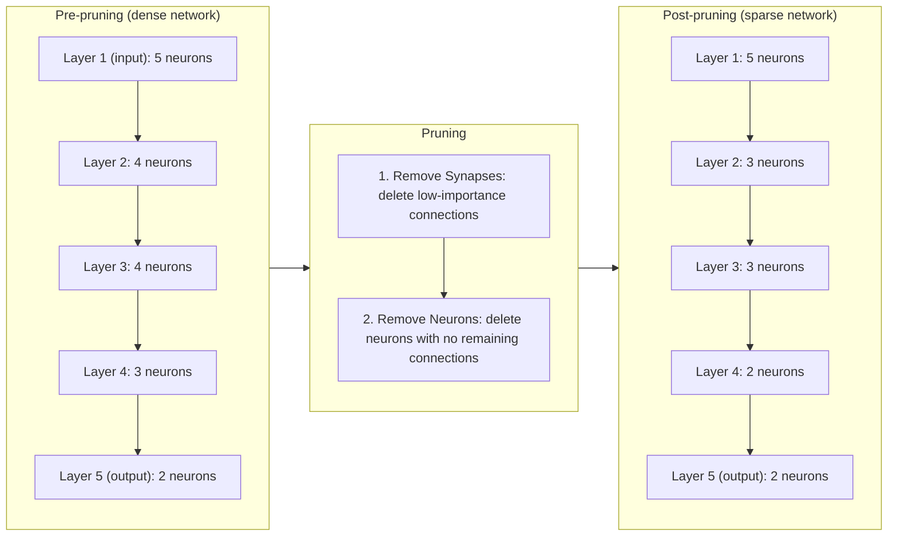
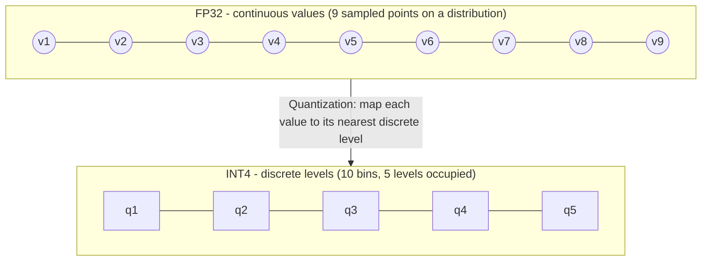
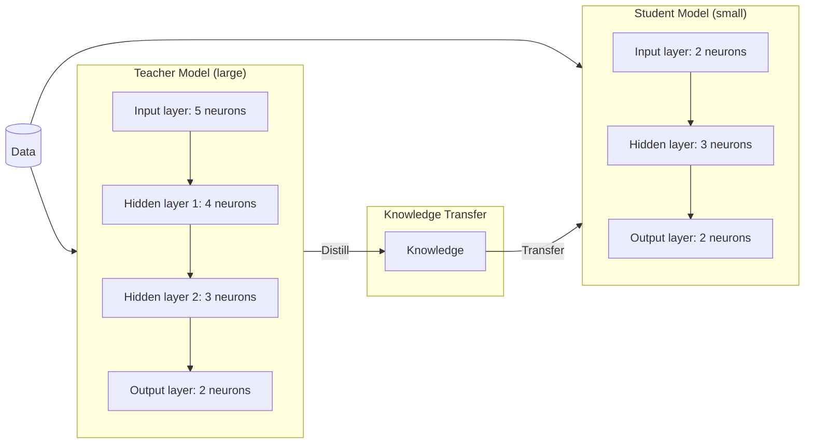

# 2.9 LLM application production practices  

## 🚄 Preface

Through previous course modules, your **Question-Answering Bot** (QAB) has already demonstrated proficiency in addressing **domain-specific knowledge** queries. This section will further explore the critical process of deploying LLM applications into **production environments**.

Transitioning from development and testing phases to real-world business scenarios involves a complex, multi-dimensional workflow requiring rigorous technical considerations. We will systematically break down these components to ensure successful operationalization.  

## 🍁 Goals
Upon completing this module, you will be equipped to:
- **Identify key deployment factors** for LLM applications in production through business requirements analysis
- **Optimize cost-performance trade-offs** in LLM application operations
- **Enhance system stability** and reliability for LLM-powered solutions

Deploying LLMs into production environments and applying them to real-world business scenarios is no easy task. It requires a comprehensive approach:

1. Start from the **business context**
2. Select the most suitable model based on **functional requirements** (such as choosing Qwen-Math for math-heavy tasks)
3. Consider **non-functional requirements** like performance, cost, security, and stability

While functional requirements define *what* the LLM does, non-functional requirements define *how well* it performs—directly impacting system quality, user experience, and operational efficiency.

Only by balancing business needs with technical implementation can you deploy and operate LLM services efficiently and effectively.

This section covers these core topics, providing a comprehensive understanding of how to deploy LLMs in real-world scenarios in a cost-effective, stable, and scalable manner. The next lesson will delve deeper into building robust compliance and security defenses for LLM applications.

## 1. Business requirements analysis

Business requirements analysis is the first step toward successfully deploying LLMs. Different business scenarios exhibit significant variations in both functional and non-functional requirements.

An unclear business scenario may lead to:
- **Model selection errors**: Choosing a model unsuitable for a specific task, resulting in poor performance or resource waste
- **Degraded user experience**: Failure to meet expectations for latency, accuracy, or consistency
- **Uncontrolled costs**: Suboptimal deployment strategies due to misalignment with business needs

Therefore, after clearly defining the business scenario, conduct an in-depth analysis centered on both functional and non-functional requirements, then formulate a concrete deployment strategy.

### 1.1 Functional requirements of the model

Different business scenarios impose distinct functional requirements on models. Below are model selection recommendations for several typical task scenarios:

#### Natural language processing (NLP)
One of the most common LLM application areas, including:
- Question answering systems
- Text generation
- Translation
- Sentiment analysis

| Task Type | Recommended Model |
|---------|-------------------|
| **General-purpose NLP** | General LLMs (such as Qwen, GPT, DeepSeek) |
| **Mathematical reasoning** | Domain-optimized models (such as Qwen-Math) |
| **Medical diagnosis** | Medical-specialized models + knowledge graphs or rule engines |

> 💡 **Note**: For high-stakes domains like healthcare and law, combine LLMs with structured knowledge bases to improve accuracy and reduce hallucinations.

#### Vision tasks
Includes image classification, object detection, and image generation. These typically require **dedicated vision models**, not general LLMs:
- **Image generation**: Tongyi Wanxiang, Stable Diffusion
- **Object detection**: YOLO series
- **Visual understanding**: Qwen-VL

#### Speech processing
Applications include:
- Voice assistants
- Automatic subtitles
- Speech-to-text input
- Text-to-speech synthesis

Use specialized models such as:
- **Qwen-Audio** for audio understanding
- **CosyVoice** for speech synthesis

#### Multimodal tasks
Integrate multiple modalities—text, images, video, speech—for complex tasks.

✅ **Recommended**: Use **multimodal models** like **Qwen-VL**  
❌ **Avoid**: Chaining multiple unimodal models (example: ASR → LLM → image generator), which leads to:
- High end-to-end latency
- Poor consistency
- Increased development complexity

After determining the task, you may have several functionally similar models to choose from (such as Qwen, GPT, and DeepSeek). To compare them objectively:

1. **Construct a custom evaluation dataset** aligned with your use case
2. Or use **public benchmarks**:
   - [MMLU](https://arxiv.org/abs/2009.03300): Measures general language understanding
   - [BBH](https://arxiv.org/abs/2210.09261): Tests complex reasoning
   - [Open LLM Leaderboard](https://huggingface.co/spaces/open-llm-leaderboard/open_llm_leaderboard#): Comprehensive model comparisons

**Model benchmark leaderboard** (reconstructed from the screenshot; rows not visible in the screenshot are omitted):

| Rank | Model | Average | IFEval | BBH | MATH | GPQA | MUSR | MMLU |
|-----:|-------|--------:|-------:|-----:|-----:|-----:|-----:|-----:|
| 1 | MaziyarPanahi/calme-3.2-instruct-78b | 52.08% | 80.63% | 62.61% | 40.33% | 20.36% | 38.53% | 70.03% |
| 2 | MaziyarPanahi/calme-3.1-instruct-78b | — | — | — | — | — | — | — |
| 3 | dfurman/CalmeRys-78B-Orpo-v0.1 | — | 81.63% | 61.92% | — | — | — | — |
| 5 | huihui-ai/Qwen2.5-72B-Instruct-abliterated | — | 85.93% | 60.49% | 60.12% | 19.35% | — | — |
| 8 | newsbang/Homer-v1.0-Qwen2.5-72B | — | — | 62.27% | 49.02% | 22.15% | 17.90% | — |
| 10 | Saxo/Linkbricks-Horizon-Al-Avengers-V1-32B | — | — | — | 60.27% | 14.99% | 18.16% | 53.25% |
| 11 | MaziyarPanahi/calme-2.2-qwen2.5-72b | — | — | — | — | — | — | — |

*The full, live leaderboard is available at the Open LLM Leaderboard link above.*

*Image Source: [Open LLM Leaderboard](https://huggingface.co/spaces/open-llm-leaderboard/open_llm_leaderboard#)*

### 1.2 Non-functional requirements of the model

Before deploying a model into production, beyond functional suitability, you must evaluate **non-functional requirements**—critical factors that determine system quality and operational efficiency.

These include:
- **Performance**: latency, throughput
- **Cost**: inference, training, API usage
- **Stability**: availability, error rate, failover
- **Scalability**: handling traffic spikes
- **Security & Compliance**: data privacy, access control

Unlike functional requirements, non-functional ones focus on *how well* the model performs under real-world conditions, not *what* it does.

## 2. Performance optimization

### 2.1 System Performance Optimization

This section outlines key principles for improving LLM system performance. These principles are universal and application-agnostic. Applying them effectively helps reduce system latency from multiple angles and enhance user experience.

#### 2.1.1 Faster Request Processing

Model size is typically the primary factor affecting inference speed. Smaller models complete inference more quickly.

For simple use cases, you can either select smaller models directly (such as Qwen2-7B) or accelerate inference through model compression and quantization. Common methods include:

- **Pruning**: Remove redundant weights or layers from the model to reduce complexity.
- **Quantization**: Use INT4, INT8, or FP16 quantization techniques to decrease computational resources required for inference.
- **Knowledge Distillation**: Train a smaller model using knowledge distillation techniques to replace the larger model for inference tasks.

##### Pruning

Remove redundant weights or layers from the model to reduce complexity, in two steps: first delete low-importance connections, then delete neurons left with no connections.

##### Quantization

Use INT4/INT8/FP16 quantization to map continuous FP32 values onto a small set of discrete levels, reducing the computational resources needed for inference.

##### Knowledge Distillation

Train a small "student" model to imitate a large "teacher" model: the teacher's distilled knowledge is transferred to the student, and both are trained on the same data.

> **Image Source**: [Knowledge Distillation: A Survey](https://arxiv.org/pdf/2006.05525)

Previous chapters discussed how to enable smaller models to perform high-quality inference:

- **Prompt Optimization**: Provide more detailed prompts through prompt expansion, or add more examples to guide the model toward better reasoning.
- **Fine-tuning**: In specific domains or tasks, fine-tuned smaller models may approach or even surpass larger models.

#### 2.1.2 Reducing Request Volume and Computation

Reducing the number of requests processed by the LLM or the amount of computation required decreases hardware load (such as GPU usage) and concurrency pressure, shortens queuing and inference time, lowers overall system latency, and improves performance.

- **Context Cache**: When using text generation models, different inference requests may share overlapping input content (such as multi-turn conversations or multiple questions about the same book). Context Cache technology caches the common prefix content of these requests, reducing redundant computations during inference and improving response speed. Qwen series models (qwen-max, qwen-plus, qwen-turbo) support [Context Cache](https://help.aliyun.com/zh/model-studio/user-guide/context-cache) by default, which significantly improves response speed and reduces costs.

- **Batch Processing**: By merging multiple requests into a single batch (consolidating similar requests or removing duplicates), you can reduce the number of requests, lower round-trip latency between requests, and improve hardware utilization. Model Studio provides [Batch Inference APIs](https://help.aliyun.com/zh/model-studio/user-guide/batch-inference) that leverage idle time resources to complete offline inference tasks.

#### 2.1.3 Reducing Token Input and Output

Reducing token input and output during LLM processing helps shrink inference time and speed up responses. This is particularly important for real-time applications such as dialogue systems and customer service chatbots.

**Input Optimization**: Streamline input content by removing redundant or irrelevant information and keeping only key details. For example, in dialogue systems, you can preprocess inputs to extract user intent and core questions rather than feeding the entire conversation history to the model. You can also generate summaries of long documents or complex inputs as model input, using a smaller summarization model or rule-based methods.

**Output Optimization**: Output optimization is often more critical than input optimization, since token generation is almost always the most time-consuming step. The simplest approach is to use prompts that explicitly request concise responses, such as "Please answer in one sentence" or "Give a very brief explanation." For structured output scenarios, optimize the output content itself by removing repetitive descriptions and shortening function names.

Additionally, when calling model APIs, you can explicitly specify the maximum output length using the `max_tokens` parameter to limit generated content. Understanding the fundamental difference between these approaches is essential:

| Method | Principle | Suitable Scenarios | Potential Issues |
|--------|-----------|-------------------|------------------|
| **Prompt Guidance** | Explicitly request "keep the answer under 100 words" in the prompt | Brief answers requiring semantic completeness (e.g., SMS notifications, summaries) | Model may occasionally exceed the limit |
| **max_tokens Parameter** | Hard cutoff at the API level; stops generation immediately upon reaching the token limit | Cost control, preventing abnormally long outputs, fallback protection in streaming scenarios | May truncate mid-sentence, resulting in incomplete semantics |

**The Philosophy Behind `max_tokens`**: `max_tokens` is fundamentally a **safety valve**, not a content control mechanism. Its core purpose is: to generate a continuable intermediate result rather than letting a single call spiral into unbounded costs, latency, and resource consumption.

Therefore, when generating **semantically complete** brief replies (such as SMS notifications), prompt guidance should be your first choice—let the model understand the constraints and actively adjust its response strategy. The `max_tokens` parameter is better suited as a last line of defense against models generating excessively long content.

#### 2.1.4 Parallel Processing

**Why Do LLMs Require GPUs Instead of CPUs?**

LLM inference fundamentally involves large-scale matrix operations. Understanding the architectural differences between CPUs and GPUs helps you make informed hardware decisions:

| Feature | CPU | GPU |
|---------|-----|-----|
| **Core Count** | Few powerful cores (typically 8–64) | Thousands to tens of thousands of simple cores |
| **Design Goal** | Complex logic, sequential tasks | Large-scale parallel computing |
| **Suitable For** | General-purpose computing, programs with complex branching | Matrix operations, deep learning inference |

**Example**: Calculating a 4096×4096 matrix multiplication—which is common in LLM inference:

- **CPU Approach**: Even with multithreading, each thread still needs to process a large number of calculations sequentially, limited by core count.
- **GPU Approach**: Computation can be distributed across thousands of cores executing simultaneously, naturally suited for scenarios with "same operation, large amount of data."

Therefore, **replacing GPUs with CPU clusters does not effectively improve LLM inference speed**—even with many cores and multithreading enabled, the CPU architecture remains unsuitable for large-scale matrix parallel operations. For scenarios requiring self-deployed LLM inference services, GPUs (or dedicated AI accelerators like NPUs) are essentially mandatory.

> 💡 **Note**: While CPUs can be used for inference in certain scenarios (such as edge devices or low-cost testing), this typically comes at the cost of inference speed. For online inference services requiring low latency, GPUs are the superior choice.

With the necessity of GPUs established, the following explains how to fully leverage GPU parallel capabilities. In LLM applications, parallel processing effectively improves computational efficiency and reduces inference or training time. By decomposing tasks into subtasks (such as data parallel, model parallel, or pipeline parallel), execution can occur simultaneously on different GPUs or servers, reducing overall time consumption.

For example, data parallel distributes shards of input data across multiple devices for processing, model parallel distributes different layers or parameters of a model across devices, and pipeline parallel divides the computation process into sequential stages. These methods significantly reduce computational pressure on single devices, overcome memory limitations, and improve throughput—providing critical support for efficient LLM deployment and operation.

#### 2.1.5 Don't Default to LLMs

While LLMs are powerful and versatile, they are not suitable for every task. Defaulting to LLMs in certain situations may introduce unnecessary latency or complexity, while simpler, classical methods can provide better performance and efficiency. The following optimization strategies help you make more informed choices:

- **Hardcoding**: Reduce dependence on dynamic generation. If outputs are highly standardized or constrained, hardcoding is often a better choice than relying on LLMs for dynamic content generation.
  - **Confirmation Messages**: Standard responses like "Your request has been successfully submitted" or "Operation failed, please retry" can be hardcoded directly without LLM generation.
  - **Rejection Messages**: Common error scenarios like "Invalid input, please check the format" can have multiple predefined variants selected randomly—efficient while avoiding repetitive responses.

- **Precomputation**: Generate and reuse content in advance. When input options are limited, you can precompute all possible responses and match them quickly to user inputs. This approach not only reduces latency but also avoids repeatedly displaying the same content.

- **Leverage Classic UI Components**: Enhance user experience. In some scenarios, traditional UI components convey information more effectively than LLM-generated text.
  - **Summary Metrics**: Use charts, progress bars, or tables to display data rather than having the LLM generate descriptive text.
  - **Search Results**: Present results through pagination, filters, and sorting functions—this is more intuitive than generating lengthy natural language descriptions.

- **Traditional Optimization Techniques**: Combine classical algorithms to improve efficiency. Classic optimization techniques remain applicable even within LLM applications.
  - **Binary Search**: Use binary search to quickly locate targets in ordered data rather than having the LLM traverse entire datasets.
  - **Hash Maps**: Use hash tables to quickly retrieve predefined responses or templates, reducing computational complexity.

### 2.2 User-Perceived optimization

Even if backend latency is high, you can improve user experience through smart UX design.

#### 2.2.1 Streaming output
Progressively return generated content to the user, reducing perceived latency.

✅ Ideal for:
- Chatbots
- Voice assistants
- Real-time translation

> ⚠️ Disable caching and compression in load balancers to avoid blocking streamed output.

*Screenshot of a chat interface (model "Qwen-Plus-Latest", "DeepThink" enabled): the user asks "Explain streaming output", and the assistant's reply arrives as one streamed block defining streaming output — sending data incrementally rather than all at once — and covering HTTP chunked encoding, SSE, WebSockets, lower perceived latency, reduced memory usage, and typical use cases (chatbots, live scores, log files).*

#### 2.2.2 Chunked processing

Break tasks into smaller chunks and process them incrementally:

- In **RAG systems**:
  - Retrieve by topic or data source
  - Generate responses paragraph by paragraph
- Return partial results as they become available

This improves responsiveness and allows users to engage with the output sooner.

#### 2.2.3 Display task progress

Show users that the system is working:
- Use progress bars
- Display estimated time remaining
- Provide intermediate results

Example:
> "Searching knowledge base... (3/5 documents retrieved)"

This reduces user anxiety during long-running tasks.

#### 2.2.4 Error handling and feedback

Design user-friendly error experiences:
- **Clear error messages**: Explain what went wrong and how to fix it
- **Gentle tone**: Avoid technical jargon or blaming the user
- **Retry mechanisms**: Auto-retry for transient errors (with rate limiting)
- **Fallbacks**: Offer alternative actions (such as a "Try again" button)

Example:
> "Sorry, I couldn't generate a response. The service is temporarily busy. Would you like to try again?"

#### 2.2.5 Provide user feedback channels

Enable continuous improvement:
- Add a "Was this helpful?" button
- Allow users to report issues or suggest improvements
- Analyze feedback to refine prompts, models, and workflows

This creates a feedback loop that drives long-term system enhancement.

## 3. Cost optimization

### 3.1 Saving costs while improving performance

Many performance optimizations also reduce costs:

| Technique | Performance Benefit | Cost Benefit |
|---------|---------------------|--------------|
| **Batch Inference** | Better resource utilization | Up to 50% lower cost |
| **Token Reduction** | Faster response | Lower compute cost |
| **Caching** | Instant response | Eliminates repeated inference |
| **Hardcoded Logic** | Near-zero latency | No LLM cost |

> 💡 **Rule of thumb**: Only use LLMs when necessary. For predictable tasks, use rules or templates.

### 3.2 Deployment strategies

Choose the right deployment model based on your business needs:

| Strategy | Use Case | Cost Efficiency |
|--------|--------|-----------------|
| **On-Demand Instances** | Stable, predictable workloads | Medium |
| **Spot Instances** | Non-critical, fault-tolerant tasks | High (up to 70% savings) |
| **Serverless (PAI-EAS)** | Variable traffic, pay-per-use | Flexible |

> 🛠 **Example**: Use spot instances for batch summarization jobs, with retry logic to handle interruptions.

## 4. Stability enhancement

### 4.1 Automated scaling

Use auto-scaling groups to dynamically adjust the number of model instances based on traffic:
- Scale up during peak times
- Scale down during off-peak times

This ensures performance without over-provisioning.

### 4.2 Real-time monitoring

Monitor key metrics:
- Latency (TTFT, TPOT)
- Error rate
- GPU utilization
- Token consumption

Set up alerts for anomalies (such as a sudden spike in errors).

### 4.3 Disaster recovery

Design for failure:
- Deploy backup models in different zones
- Use fallback to smaller models if large ones fail
- Maintain offline knowledge caches

> 🔁 **Note**: Regularly test recovery plans with simulated outages.

## ✅ Summary

In this section, we covered:
- **Key elements for deploying LLM applications to production**, including:
  - Functional requirements (model selection by task)
  - Non-functional requirements (performance, cost, stability)
- **Performance and cost optimization strategies**:
  - Model compression, caching, batching, token reduction
  - Streaming, chunked processing, progress display
- **User experience enhancements**:
  - Error handling, feedback loops, UX design
- **Stability improvements**:
  - Auto-scaling, monitoring, disaster recovery

By combining these practices, you can build LLM applications that are not only powerful but also efficient, reliable, and user-friendly in real-world business environments.
